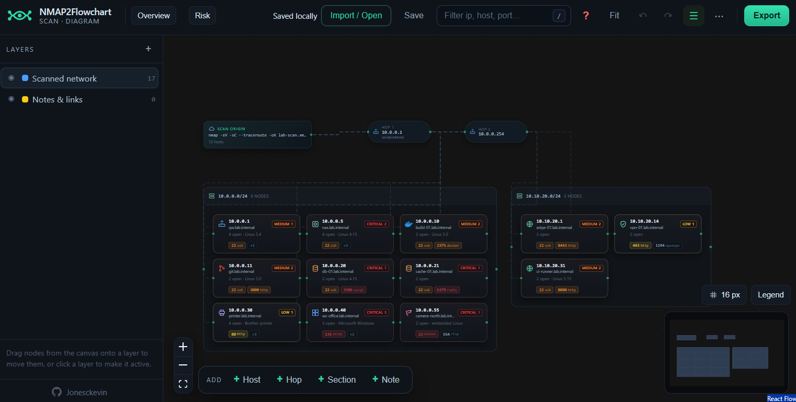

# NMAP2Flowchart – static (GitHub Pages) edition

The whole NMAP2Flowchart editor @ **https://nmap2flowchart.4n6post.com/**

Drop in `nmap -oX` XML and get a zoomable, grid-backed diagram of subnets, hosts, open ports and traceroute hops. Reshape it with layers, sections, notes, icons and hand-drawn connections, then export to **draw.io**, **Mermaid**, or print-ready **SVG / PNG / PDF**.

Everything happens in the browser – the scan and the diagram never leave the machine. That also means this build has **no accounts, no saved projects and no shared rooms**: those belong to the [server build](../App/server), and the app itself is written to work without any backend.



## Where the code comes from

`src/` is a **generated copy** of the app in the main repository
[Jonesckevin/NMAP2Flowchart → `App/src`](https://github.com/Jonesckevin/NMAP2Flowchart/tree/main/App/src)

## Local development

```bash
npm ci
npm run dev      # http://localhost:5173
npm run lint     # oxlint
npm run build    # tsc -b && vite build -> dist/
npm run preview  # serve dist/ the way Pages will
```

## License

MIT – see [LICENSE](./LICENSE).
